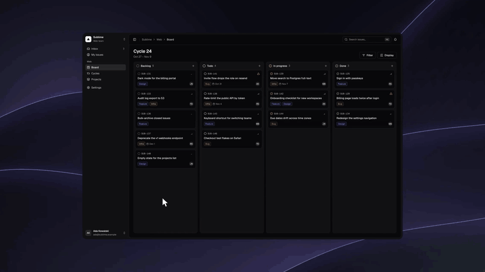
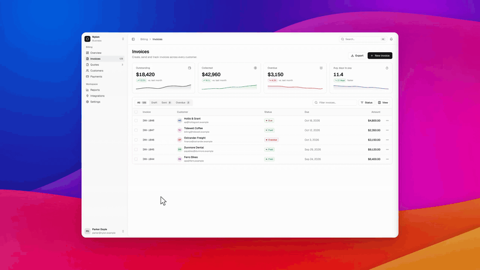

<p align="center">
  <picture>
    <source media="(prefers-color-scheme: dark)" srcset="brand/banner_dark.svg">
    
  </picture>
</p>

<p align="center">
  <a href="https://github.com/demoman-io/demoman/actions/workflows/ci-ts.yml"></a>
  <a href="https://www.npmjs.com/package/demoman"></a>
  <a href="LICENSE"></a>
  <a href="https://demoman.io/docs"></a>
  <br />
  <a href="#install"></a>
  <a href="#install"></a>
  <a href="#install"></a>
  <a href="#install"></a>
  <a href="https://demoman.io/docs/get-started/connect"></a>
  <a href="#install"></a>
</p>

# Demoman

**Self-recording, self-updating product demos.**

Record demos with your agent. Each flow is saved, and CI keeps it current.

<p align="center">
  
</p>

## Install

macOS or x86_64 Linux, and Node 20.12 or later:

    npx demoman setup

Setup downloads Chromium and connects Demoman to Claude Code, Codex, Cursor
and OpenCode, whichever it finds. Restart the agent, then ask it for a demo.
For another MCP client, see
[Connect your agent](https://demoman.io/docs/get-started/connect). On Linux,
setup names the one `sudo` command that installs Chromium's system libraries.
Demoman is in public beta.

## Agent-native recorder

**Ask for a demo. Get a video.** Your coding agent drives Demoman through its
MCP server. It handles sign-in, runs the flow in a headless browser and hands
back a demo video, with the camera, cursor and framing already done.

```text
> record a demo of creating an invoice

⏺ demoman.run  "a new invoice"  10 steps
  ⎿ complete · 5 inside · 0 cut off · 0 detours
⏺ demoman.export
  ⎿ saved ~/Downloads/Nylon — New Invoice (Desktop).mp4
```

<p align="center">
  
</p>

| | |
| --- | --- |
| Interface | CLI · MCP server |
| Browser | Headless Chromium |
| Devices | Desktop · Tablet · Phone |
| Sign-in | [Demo accounts · Seed scripts](https://demoman.io/docs/get-started/sign-in) |

## CI pipeline

**Video as Code.** One command adds Demoman to GitHub Actions. From then on,
every merge records each DemoScript again against your real app, and a video
changes only when the product did.

```bash
npx demoman add "Export report" --to docs/export-report.mp4
npx demoman setup --ci
```

`add` saves the flow's DemoScript in `.demoman/flows/` beside its export.
`setup --ci` records your flows once from a clean checkout, shows one plan
and opens the pull request that sets it up. After that, each refresh opens a
pull request with the videos that changed.

```json
{
  "name": "Export report",
  "target": "http://localhost:3000/reports",
  "steps": [
    { "do": "waitForLoad" },
    { "do": "click", "on": { "stableId": "range-12m" } },
    { "do": "click", "on": { "stableId": "export-report" } },
    { "do": "waitFor", "until": "visible", "on": { "text": "Report exported" } }
  ]
}
```

| | |
| --- | --- |
| Source | DemoScripts in `.demoman/flows/` |
| Format | JSON, schema-validated |
| CI | GitHub Actions |
| Trigger | Every merge, a deployment, a release, or daily |
| Review | A video on the pull request |

[Keep videos current](https://demoman.io/docs/get-started/ci) covers the
triggers, committing to the branch instead, and keeping videos out of git.

## Principles

- **Runs on your machines.** Your laptop or your CI runner. Capture and
  export happen there, and Demoman sends nothing to us.
- **Your screen stays yours.** Demoman records in a browser of its own.
- **No account.** Install it and ask your agent.

## Specifications

| | |
| --- | --- |
| Agents | Claude Code, Codex, Cursor, OpenCode |
| Platforms | macOS, Linux (x86_64). Node 20.12+ |
| Output | MP4 at 60 fps, up to 2560 px wide. GIF. A PNG still of every step |
| Editor | [Studio](https://demoman.io/docs/studio/overview), optional: trim, cut, zoom, background |

Documentation: [demoman.io/docs](https://demoman.io/docs)

## Contributing

Demoman is not accepting pull requests from outside.
Bug reports and ideas are welcome as issues.
